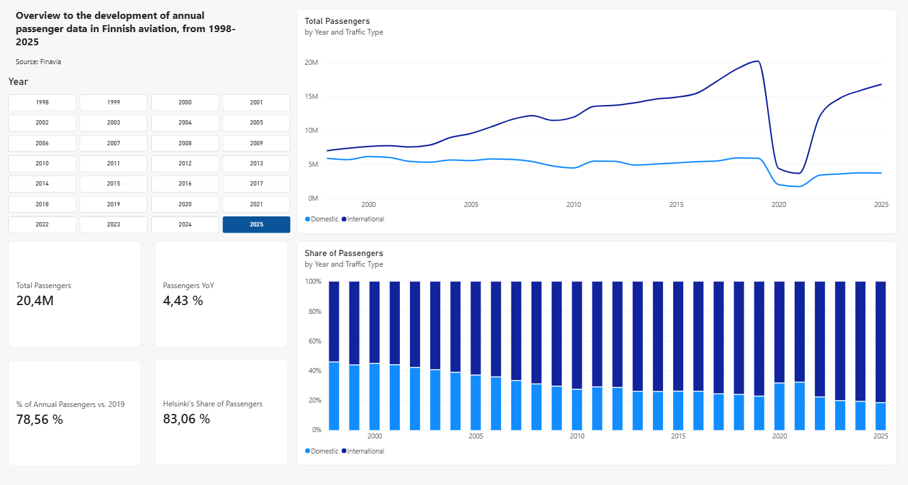
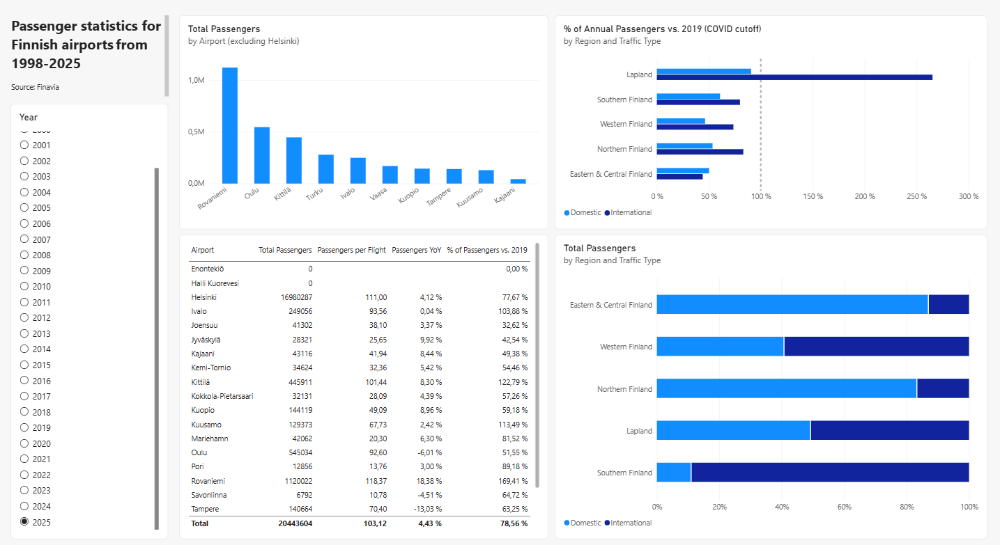

# Finnish Air Traffic Visualizations - Power BI Dashboard (1998–2025)

A Power BI report on passenger traffic at 21 airports, built from Finavia's public traffic statistics. The project covers the full BI-tool workflow: cleaning five wide-format Excel files with Power Query, building a star schema with shared dimensions, and using DAX for measures to calculate year-over-year change, recovery from COVID-19 and passengers per flight.

Source: Finavia, Traffic statistics (long-term statistics 1998–2025).

## Dashboard

The `.pbix` file can be found and opened from the main branch of this repository.

**Page 1 — Overview**

**Page 2 — Airports**

## Key Findings

- **Traffic has not recovered to the pre-pandemic peak.** In 2025, Finavia's airports handled 20.4M passengers, 78.6 % of the 2019 peak (26.0M). Traffic fell by roughly 75 % in 2020.
- **International traffic has recovered faster than domestic.** In 2025, international traffic was at 83 % of its 2019 level, domestic traffic only at 63 %.
- **Domestic traffic's share has been shrinking for decades.** Domestic passengers made up 46 % of all passengers in 1998, 23 % in 2019 and 18 % in 2025. The decline is a long-term trend, not an effect of the pandemic. During 2020–2021 the domestic share rose temporarily, because international traffic collapsed more sharply due to international COVID restrictions.
- **Lapland is an exception.** Rovaniemi (169 %), Kittilä (123 %), Kuusamo (113 %) and Ivalo (104 %) have all exceeded their 2019 passenger numbers, and international traffic to Lapland is more than 2.5 times its 2019 level. Most other regional airports remain well below 2019 (e.g. Oulu 52 %, Tampere 63 %).
- **Traffic is highly concentrated.** Helsinki-Vantaa handled 83 % of all passengers at Finavia's airports in 2025 (although there has not been significant rise in Helsinki's share over the last 10 years).

## Data

- **Not all data was used for the final visualizations.**

| File | Content | Period |
|---|---|---|
| Passengers by Airport | Domestic and international passengers per airport | 1998–2025 |
| Landings by Airport | Domestic and international commercial landings per airport | 1998–2025 |
| Helsinki Airport passengers | Arriving, departing and transfer passengers at Helsinki-Vantaa | 1998–2025 |
| Int. scheduled / chartered flight passengers by country | International passengers by destination country | 2013–2025 |

**Limitations:** the data is annual, covers only Finavia's airports and is not split by airline. Airport passenger figures count both arriving and departing passengers, so a domestic trip is counted at both ends.

## Data Preparation (Power Query)

All five files were in a wide, presentation-oriented format and were reshaped into long tables (one row per observation):

- **Multi-row headers with merged cells** (year / traffic type / measure): Transpose > Fill Down > Merge Columns > Transpose back > Use First Row as Headers.
- **Years as columns:** Unpivot Other Columns, then Split Column to separate year and category.
- **Subtotals mixed with data** (*Yhteensä*, *EU yhteensä*, *KAIKKI YHTEENSÄ*): removed to avoid double counting. All totals are calculated with DAX instead.
- **Pre-calculated change-% columns removed:** percentages cannot be aggregated correctly, and they contained text values ("/0"). Year-over-year change is calculated with DAX so that it stays correct under any filter.
- **Empty columns caused by merged cells:** removed before filling down.
- **Year > Date:** a date column (`#date([Year], 1, 1)`) was added to every fact table so that it can relate to the date table.
- **Scheduled and charter traffic** were appended into one table with a `FlightType` column.

## Data Model

A star schema with four fact tables and four shared dimensions:

| Table | Type | Purpose |
|---|---|---|
| fact_AirportPassengers | Fact | Passengers by airport, year and traffic type |
| fact_Landings | Fact | Landings by airport, year and traffic type |
| fact_HVpassengers | Fact | Helsinki-Vantaa passengers by passenger type (arriving / departing / transfer) |
| fact_CountryPassengers | Fact | International passengers by destination country and flight type |
| dim_Date | Dimension (DAX `CALENDAR`) | Shared time dimension, marked as date table |
| dim_Airport | Dimension (Enter Data) | Airport, region, airport type; Region → Airport hierarchy |
| dim_TrafficType | Dimension (Enter Data) | Domestic / International |
| dim_Country | Dimension (CSV) | Country names in English, region and continent |

Shared dimensions are what make the model work: one slicer filters every fact table consistently. Without a shared `dim_TrafficType`, for example, splitting passengers and landings by traffic type in the same visual would filter only one of the two tables, and *Passengers per Flight* would be silently wrong.

The Helsinki-Vantaa and destination country tables are modelled and ready for further report pages (transfer traffic, destination markets).

## DAX Measures

All measures are collected in a dedicated measure table.

| Measure | Purpose |
|---|---|
| Total Passengers, Total Landings | Base measures |
| Passengers per Flight | Average passengers per flight |
| International Passengers / International Share | `CALCULATE` with a traffic type filter |
| Helsinki Share | Helsinki-Vantaa's share of all passengers |
| Passengers PY, Passengers YoY | Time intelligence (`SAMEPERIODLASTYEAR`, quick measure) |
| Passengers 2019, Recovery vs. 2019 | Recovery compared to the pre-pandemic peak |
| Avg Annual Passengers, Peak Year Passengers | Iterators (`AVERAGEX`, `MAXX`) |

**Passengers per Flight** — passenger figures include both arriving and departing passengers, but each flight is recorded as a landing only at its destination. Every landing at an airport is matched by a departure, so the number of flights handled is approximately 2 x landings.

**Recovery vs. 2019** — `CALCULATE` replaces the year selected in the report with 2019, while keeping all other filters (airport, traffic type).

## Visualization Decisions

- **Single-select year slicer:** the cards show one year at a time. With multiple years selected, measures such as YoY and Recovery vs. 2019 would combine years into figures that cannot be interpreted.
- **Trend charts are not filtered by the slicer** (edited interactions), so the user always sees a selected year against the full 1998–2025 history.
- **100 % stacked column for the domestic / international mix:** an earlier version compared average passengers per period (pre-COVID / COVID / recovery). It was rejected because the pre-COVID average mixed very different years and made the recovery period look larger than the 2019 peak. Showing the share year by year reveals the long-term trend directly.
- **Top N filter:** the airport ranking excludes Helsinki-Vantaa, which would otherwise dwarf every other airport.
- **Reference line at 100 %** in the recovery chart shows at a glance which regions have exceeded their 2019 level.

## Use of AI

This project was built with an AI assistant (Claude) acting as a mentor rather than a builder - AI was not leveraged as much as it could have been for learning purposes:

- **Guidance and review:** when I got stuck, the AI suggested the next steps.
- **Mechanical tasks:** the AI produced the `dim_Country` lookup table (country name translations, regions, continents) and drafted this README from the work steps I had documented during the project.

All implementation in Power BI was done by me (Power Query transformations, data model, DAX measures and report design). I verified every result against the source data and made the final design decisions, for example replacing the period comparison chart with a yearly 100 % stacked chart.

## Tools

| Tool | Purpose |
|---|---|
| Power BI Desktop | Report development |
| Power Query | Data transformation |
| DAX | Measures, date table and calculated columns |

## Author

Juuso Forsman

- BSc., Information and Service Management, Aalto University (from Sep. 2022)
- MSc., Business Analytics, Aalto University (from Sep. 2026)

